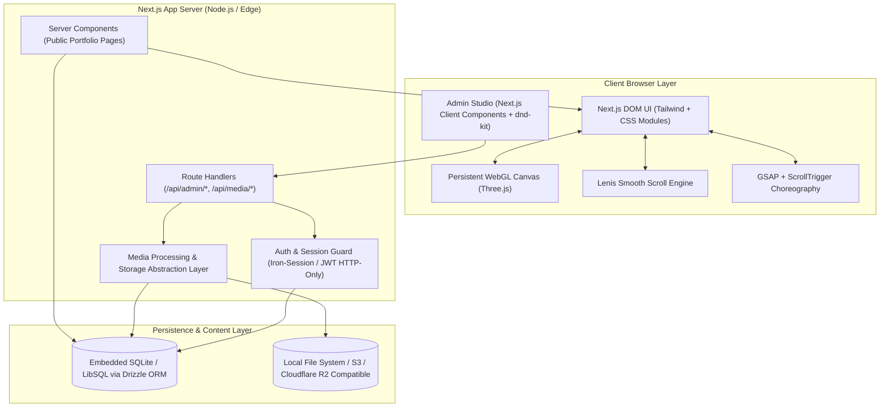
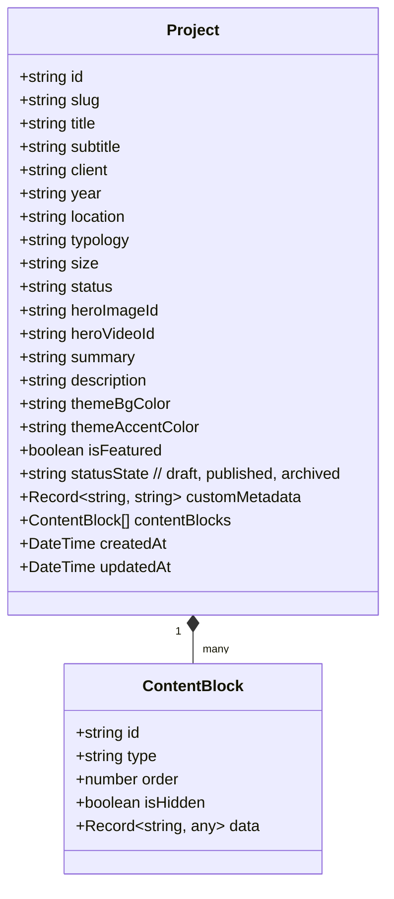
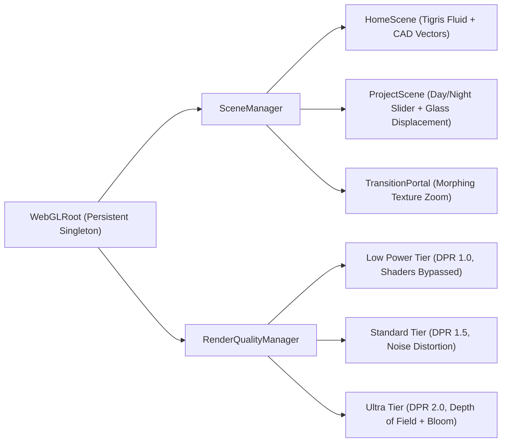

# CVI ARCHITECTS — FULL-STACK SYSTEM ARCHITECTURE SPECIFICATION
**Document Version:** 1.0.0  
**Role:** Senior Full-Stack Architect & Principal Creative Technologist  
**Workspace:** `/Users/swibit/Projects/CVI`  
**Date:** September 30, 2026  

---

## 1. Architectural Philosophy & Technology Stack

The digital platform for CVI Architects is engineered as a **hybrid high-performance architecture**:
- **Public Portfolio Experience:** Ultra-fast Server-Side Rendered (SSR) and Incremental Static Regeneration (ISR) pages powered by Next.js App Router, delivering instant First Contentful Paint (FCP) and optimal SEO indexing, layered with a fluid WebGL/Three.js orchestration pipeline.
- **Content Management System (CMS):** A secure, authenticated, real-time editorial studio enabling editors to craft block-based architectural case studies, manage media libraries, update studio metadata, and preview drafts without touching code.



### Technology Decisions & Justifications

| Layer | Selected Technology | Technical Rationale |
|---|---|---|
| **Core Framework** | **Next.js 15+ (App Router)** | Best-in-class hybrid SSR/Static generation, automatic image optimization, route handlers, server actions, and deep React 19 concurrent feature support. |
| **Language** | **TypeScript (Strict Mode)** | 100% type safety across database schemas, CMS block definitions, API payloads, and WebGL state uniforms. Zero untyped `any`. |
| **Styling** | **Tailwind CSS + CSS Modules + Custom Tokens** | Utility classes for layout speed paired with CSS Custom Properties for design tokens, fluid clamp() typography, and complex animation isolation. |
| **Smooth Scrolling** | **Lenis (@studio-freight/lenis)** | Standard-bearing inertia scrolling engine; zero layout thrashing, native keyboard/accessibility passthrough, and seamless GSAP ScrollTrigger synchronization. |
| **Animation Engine** | **GSAP (GreenSock) + ScrollTrigger** | Industry-standard timeline choreography, precise transform matrix calculations, SVG path tracing, and rock-solid cross-browser consistency. |
| **WebGL & 3D** | **Three.js + React Three Fiber / Custom Canvas** | Native Three.js shader materials, procedural geometries, post-processing composer, and dynamic DPR scaling. R3F used modularly where reactive scene trees benefit UX. |
| **Persistence / ORM** | **SQLite (Better-SQLite3 / LibSQL) + Drizzle ORM** | Zero-latency embedded SQL database running locally out-of-the-box with zero Docker or remote database dependencies required for setup, with an instant one-line migration path to PostgreSQL / Supabase for cloud deployment. |
| **Authentication** | **Encrypted Session / JWT in HTTP-Only Cookies** | Secure authentication with Argon2 / bcrypt password hashing, CSRF-token protection, and strict server-side middleware route guards. No hardcoded PINs or frontend security theater. |
| **Validation** | **Zod** | End-to-end schema validation for database records, CMS blocks, form inputs, and media uploads. |
| **Drag & Drop** | **@dnd-kit/core + @dnd-kit/sortable** | Accessible, touch-friendly, performant reordering for the block-based case study builder and gallery managers. |
| **Media Processing** | **Sharp + Modern Next/Image** | Automatic WebP/AVIF generation, blurhash placeholders, dimension extraction, and EXIF metadata stripping. |

---

## 2. Content Modeling & Block-Based Case Study Schema

To fulfill the requirement that **no project layout is hardcoded**, project case studies are structured as a sequential array of typed **Content Blocks**.



### Supported Content Block Types
1. **`TextBlock`:** Rich editorial paragraphs, columns, and lead paragraphs.
2. **`HeadingBlock`:** Section divisions, architectural chapter headers, and Roman numeral markers.
3. **`ImageBlock`:** Single standard or wide architectural still with caption and credit.
4. **`FullBleedImageBlock`:** Viewport-spanning photographic immersion with parallax depth.
5. **`TwoColumnBlock`:** Split layout pairing technical narrative on the left with drawings/renders on the right.
6. **`GalleryBlock`:** Dynamic masonry or responsive grid showcasing multiple architectural views.
7. **`HorizontalGalleryBlock`:** Pinned horizontal scroll strip for sequential masterplans or facade elevations.
8. **`StickyMediaBlock`:** Pinned drawing or render on one side while descriptive text scrolls alongside it.
9. **`VideoBlock`:** Autoplay loop or interactive video player for cinematic walkthroughs.
10. **`QuoteBlock`:** Editorial architect's statement, client testimonial, or design philosophy quote.
11. **`StatsBlock`:** Grid of numeric callouts (Area in m², Concrete volume, LEED certification, Completion year).
12. **`BeforeAfterBlock`:** Interactive split-screen slider comparing schematic CAD wireframe vs finished raytraced render, or daytime vs nighttime illumination.
13. **`ThreeDModelBlock`:** Interactive WebGL 3D model viewer with orbit controls, exploded view, and lighting controls.
14. **`WebGLBlock`:** Custom procedural shader canvas (e.g. solar shadow study, wind flow particle simulation).
15. **`SpacerBlock`:** Controlled architectural breathing room with configurable heights and optional divider rules.

---

## 3. Global CMS Content Model

The CMS provides comprehensive management across the entire platform:

```typescript
// Core Data Schema Architecture (Drizzle ORM & Zod)

export interface GlobalSettings {
  id: string;
  companyName: string;            // "CVI Architects"
  tagline: string;                // "Architectural Tectonics & Urban Vision"
  legalName: string;              // "CVI Architects Ltd."
  addressLine1: string;           // "Al-Wuzara Street (Ministers St)"
  addressLine2: string;           // "Al-Jadriya, Baghdad, Iraq"
  latitude: number;               // 33.2905386
  longitude: number;              // 44.3923889
  email: string;                  // "info@cvi-iq.com"
  phone: string;                  // "+964 781 997 5070"
  facebookUrl: string;
  instagramUrl: string;
  twitterUrl: string;
  linkedinUrl: string;
  copyrightText: string;
  defaultSeoTitle: string;
  defaultSeoDescription: string;
  defaultOgImage: string;
}

export interface NavigationItem {
  id: string;
  label: string;
  href: string;
  order: number;
  isVisible: boolean;
  isExternal: boolean;
}

export interface MediaAsset {
  id: string;
  filename: string;
  url: string;
  mimeType: string;
  sizeBytes: number;
  width: number;
  height: number;
  altText: string;
  caption?: string;
  credit?: string;
  blurDataUrl?: string;
  focalPointX?: number; // 0.0 - 1.0 (center 0.5)
  focalPointY?: number;
  createdAt: string;
}

export interface TeamMember {
  id: string;
  name: string;
  role: string;
  department: string;
  bio: string;
  avatarUrl: string;
  order: number;
  isLeadership: boolean;
}

export interface StudioPillar {
  id: string;
  title: string;
  tagline: string;
  description: string;
  imageUrl: string;
  order: number;
}

export interface ServiceOffering {
  id: string;
  title: string;
  description: string;
  imageUrl: string;
  order: number;
}
```

---

## 4. Media Storage & Delivery Abstraction

To ensure portability across Cloudflare R2, AWS S3, Supabase Storage, and local development, we implement the **Provider Pattern**:

```typescript
export interface MediaStorageProvider {
  upload(file: Buffer, filename: string, mimeType: string): Promise<MediaAsset>;
  delete(assetId: string): Promise<boolean>;
  getUrl(assetId: string): string;
}

// Implementations:
// 1. LocalDiskStorageProvider (zero-configuration dev storage in /public/uploads)
// 2. S3CompatibleStorageProvider (for production deployment to R2 / AWS / MinIO)
```

Every uploaded image is automatically analyzed:
1. Dimensions (`width`, `height`) extracted via `sharp`.
2. Low-Quality Image Placeholder (LQIP / `blurDataURL`) generated (16px base64 data URI).
3. MIME type and file extension strictly validated against allowable architectural formats (`image/jpeg`, `image/png`, `image/webp`, `image/avif`, `video/mp4`, `video/webm`, `model/gltf-binary`, `application/pdf`).
4. Safe alphanumeric slugified filenames preventing directory traversal attacks.

---

## 5. WebGL Pipeline Architecture

A single persistent global WebGL canvas (`<canvas id="cvi-gl-root">`) stays mounted throughout the user journey, preventing browser context losses and shader recompilation pauses during page navigation.



### Resource Disposal & Garbage Collection
Whenever routes change or heavy textures are swapped, the `WebGLRoot` actively disposes of geometries, textures, materials, and framebuffers (`geometry.dispose()`, `material.dispose()`, `texture.dispose()`) to maintain steady memory utilization below 120MB VRAM on desktop.

---

## 6. Security Architecture

1. **Authentication Session:**
   - Admin routes (`/admin/*`) and mutation APIs (`/api/admin/*`) are protected by an encrypted session token stored in an `httpOnly`, `sameSite=lax`, `secure` cookie.
   - Passwords hashed using standard cryptographic salt/hash routines.
   - Protection against brute force via rate-limiting middleware.
2. **Input Sanitization & CSRF:**
   - All mutation endpoints validate payloads strictly via Zod.
   - Rich text inputs sanitized using `sanitize-html` to prevent stored XSS attacks.
3. **No Frontend Hardcoded Secrets:**
   - Environment variables cleanly partitioned into public (`NEXT_PUBLIC_*`) and private server-only credentials.

---

## 7. Quality Assurance, Testing & Performance Targets

### Core Web Vitals Targets
- **LCP (Largest Contentful Paint):** < 1.8s (Desktop), < 2.5s (Mobile)
- **CLS (Cumulative Layout Shift):** < 0.05 (Strict aspect-ratio reservation)
- **INP (Interaction to Next Paint):** < 100ms
- **FPS:** Locked ~60 FPS during smooth scroll and WebGL animations on standard hardware.

### Testing Plan
- **Unit Tests (Vitest):** Data transformations, slug generators, Zod schema validation, block reordering logic.
- **Component Tests (React Testing Library):** Navigation menus, block renderers, metadata grids.
- **E2E Tests (Playwright):** Full user flows:
  - Homepage load and preloader dismissal.
  - Project case study navigation and block rendering.
  - Admin login, authentication persistence, and project editing.
  - Media upload and draft-to-publish cycle.
